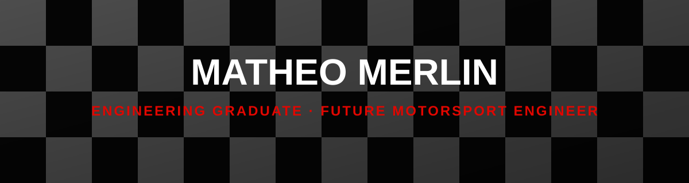

---

## 🏁 Pit briefing

I'm a **robotics and embedded systems engineering student**. What fascinates me about motorsport is everything you don't see on TV: sensors, ECUs, telemetry, energy management, real-time strategy.

A modern single-seater is hundreds of sensors, an onboard network, and data analyzed in milliseconds. **That's exactly the playground I'm building towards, project after project.**

- 🔧 I design complete systems: sensors → processing → communication → action
- 📡 I work on long-range wireless communication (LoRaWAN)
- 🤖 I simulate and control robots (navigation, fleets, robotic arm)
- 🏎️ I'm aiming for motorsport engineering: embedded electronics, data acquisition, control systems

---

## 🧰 Tech stack

**Languages & frameworks**

**Embedded & hardware**

**Simulation & tools**

**Platforms & environments**

---

## 🚀 Projects: my telemetry

| Project | What it does | Motorsport connection | Stack |
|:--|:--|:--|:--|
| 🌾 [**AgriFlow**](https://github.com/Mafuo-git/AgriFlow) | Connected irrigation system deployed across a multi-hectare field, wireless communication via LoRaWAN | Distributed sensor network and reliable data transmission, like track-to-pit telemetry | LoRaWAN · IoT |
| 🧭 [**Robot_Navigation**](https://github.com/Mafuo-git/Robot_Navigation) | Game grid with a robot, walls and empty spaces: path planning and obstacle avoidance | Pathfinding and decision-making, the foundation of autonomous driving and driver-assist systems | C++ |
| ♿ [**Flotte_de_fauteuils_roulants**](https://github.com/Mafuo-git/Flotte_de_fauteuils_roulants) | Simulation of a wheelchair fleet (CoppeliaSim + MATLAB) to model their movements before real-world deployment | Simulate before hitting the track: validate the model virtually before physical testing | MATLAB · CoppeliaSim |
| 🌦️ [**mini_weather_station**](https://github.com/Mafuo-git/mini_weather_station) | Weather station built with a Raspberry Pi 3 B+ and an Arduino Uno | Data acquisition and sensor → computer architecture, like reading track conditions during a race | Python · Arduino |
| 🦾 [**automatic_watering_Niryo_Ned2**](https://github.com/Mafuo-git/automatic_watering_Niryo_Ned2) | Guide to automate plant watering with the Niryo Ned 2 robotic arm | Precision robotics, repeatable and controlled motion | C++ |
| 🪐 [**solar_system**](https://github.com/Mafuo-git/solar_system) | Interactive 3D solar system | Data visualization and real-time rendering, useful for telemetry dashboards | JavaScript · Three.js |

---

## 🏎️ Why F1 electronics?

> In F1, performance is won as much in code and electronics as on the asphalt.

What draws me in:

- **Data acquisition**: sensors, sampling rates, signal reliability
- **Onboard networks**: communication between ECUs, latency, robustness
- **Control systems**: energy management, braking, vehicle dynamics
- **Simulation**: validate, iterate, optimize before going out on track

---

## 🎯 Goals

- [x] Deliver complete projects, from sensor to actuator
- [x] Master wireless communication (LoRaWAN)
- [x] Dive deeper into CAN bus and automotive electronics
- [x] Build a real-time telemetry / data logging project
- [ ] Join a motorsport team (internship, work-study, or a student project like Formula Student)

---

## 📊 GitHub stats

---

## 📫 Pit wall: get in touch

A project, an internship, a student team, or just a technical chat about F1? I'd love to hear from you.

